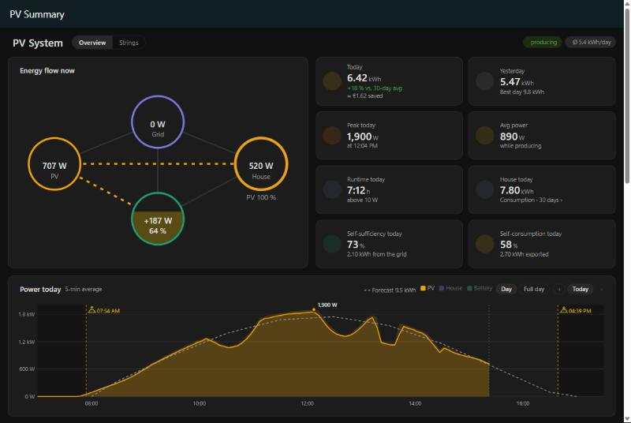
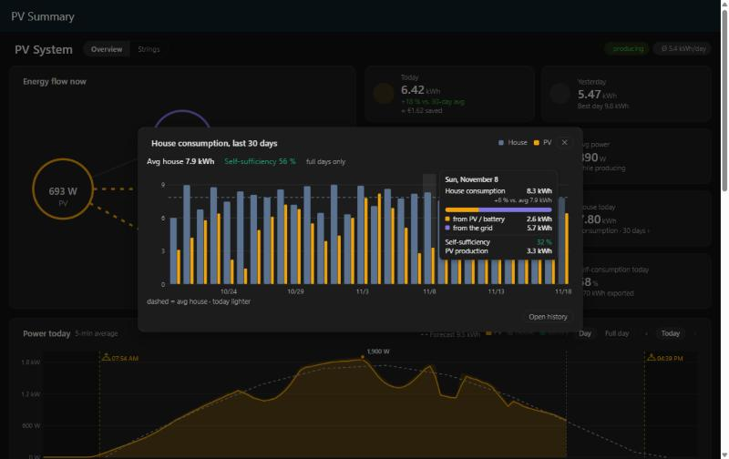
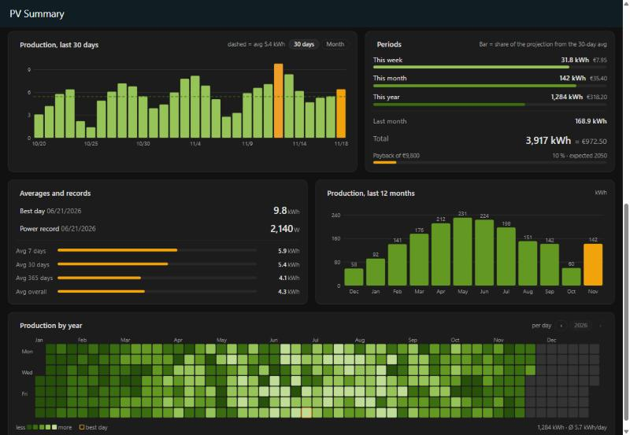
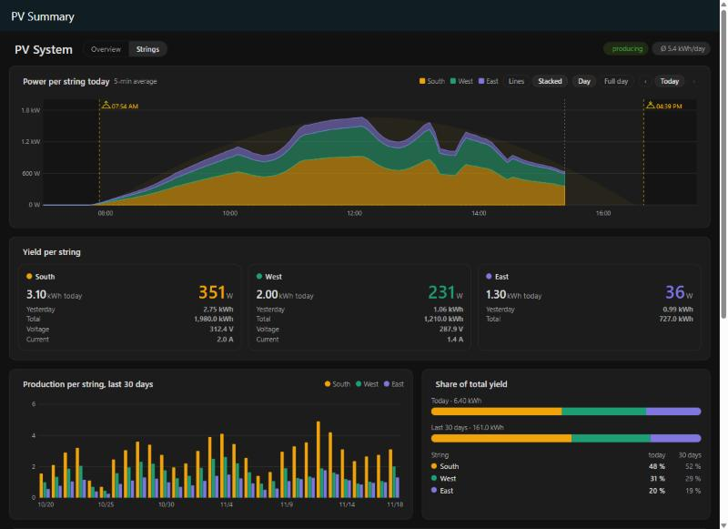
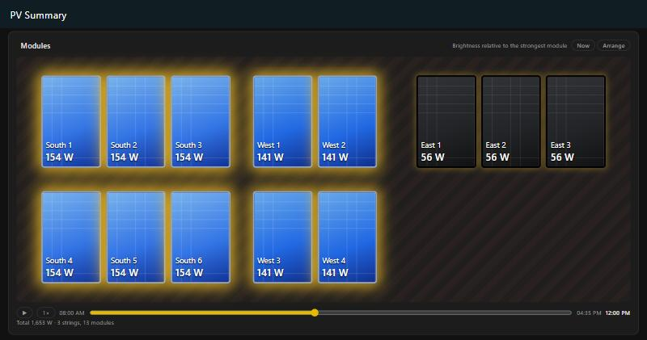

# PV Summary, Home Assistant Integration

  <picture></picture>
  <picture></picture>
  <picture></picture>
  
  <picture></picture>
  
  <picture></picture>
  
  

[English version](README.md)

Du gibst nur **einen Sensor mit der aktuellen PV-Leistung** (W oder kW) an, die Integration rechnet daraus Energie und Statistiken. Optional kommen Netz-Zähler (oder Hausverbrauch), beliebig viele Akkus und einzelne PV-Strings dazu. Ein eigenes Dashboard erscheint automatisch als **PV Summary** in der Seitenleiste.

Voraussetzung ist Home Assistant **2025.3** oder neuer. Einrichtung und Dashboard gibt es auf Deutsch und Englisch, sie folgen der Spracheinstellung von Home Assistant.

## Installation über HACS

1. In HACS nach **„PV Summary“** suchen → Herunterladen → Home Assistant neu starten
2. **Einstellungen → Geräte & Dienste → Integration hinzufügen → „PV Summary“**

Taucht PV Summary in der HACS-Suche noch nicht auf (die Aufnahme in die Standardliste von HACS läuft noch), füge es zuerst als benutzerdefiniertes Repository hinzu:

1. HACS → Menü (⋮) → **Benutzerdefinierte Repositories**
2. Repository `https://github.com/berwil84afk/ha-pv-summary`, Typ **Integration** → Hinzufügen
3. Danach weiter mit den Schritten oben

## Manuelle Installation

1. Ordner `custom_components/pv_overview` nach `/config/custom_components/pv_overview` kopieren
   (z. B. mit dem File-Editor- oder Samba-Add-on).
2. Home Assistant neu starten.
3. **Einstellungen → Geräte & Dienste → Integration hinzufügen → „PV Summary“**.
4. Name, PV-Leistungssensor, Schwelle (Standard 10 W) und optional Netzleistung (Zähler), Hausverbrauch und bisherigen Zählerstand eingeben.

Später änderbar über **Konfigurieren** an der Integration: Quellsensor, Netz, Hausverbrauch und Schwelle. Dort trägst du auch die Preise für die Ersparnis ein (siehe unten). Akkus und Strings legst du an der Integration über **Akku hinzufügen** und **String hinzufügen** an.

## Netz und Hausverbrauch (optional)

- **Netzleistung (Zähler)**: Sensor am Netz-Zähler, positiv = Bezug, negativ = Einspeisung (W oder kW). Meldet dein Zähler es umgekehrt, setze **Vorzeichen Netz umkehren**. Daraus entstehen *Netzbezug heute/gesamt* und *Einspeisung heute/gesamt*. Die Gesamt-Zähler kannst du im **Energie-Dashboard** unter „Stromnetz“ eintragen.
- **Hausverbrauch** wird dann berechnet: Haus = PV + Netz − Akku (Akku positiv beim Laden). Daraus entstehen *Hausverbrauch*, *Hausverbrauch heute* und *Hausverbrauch gesamt*.
- Hast du stattdessen einen Sensor, der wirklich den Verbrauch des Hauses misst, trage ihn unter **Hausverbrauch** ein. Ohne Netz-Zähler wird die Netzleistung dann daraus berechnet (Netz = Haus + Akku − PV).
- Den Sensor *Netzleistung* gibt es in beiden Fällen, also mit Netz-Zähler oder mit Hausverbrauch. Netzbezug und Einspeisung als Energie gibt es nur mit Netz-Zähler.
- Beim Update auf v1.7 wird ein bisher unter „Hausverbrauch“ eingetragener Sensor einmalig ins Feld **Netzleistung (Zähler)** übernommen, weil das bis v1.6 meist der Zähler war. Misst dein Sensor wirklich den Hausverbrauch, trag ihn unter **Konfigurieren** wieder dort ein und leere das Netz-Feld.

## Akkus (optional, beliebig viele)

An der Integration unter **Einstellungen → Geräte & Dienste → PV Summary** legst du über **Akku hinzufügen** einen oder mehrere Akkus an. Jedes Feld ist optional:

| Feld | Erwartet |
|---|---|
| Akkustand | Sensor in % |
| Lade-/Entladeleistung | **ein** Sensor mit Vorzeichen in W oder kW (positiv = Laden) |
| Vorzeichen umkehren | einschalten, wenn dein Sensor beim Entladen positive Werte meldet |
| Kapazität | kWh, gewichtet den gemeinsamen Akkustand |
| Akkuspannung, Akkutemperatur | Sensoren in V/mV bzw. °C/°F |

- Jeder Akku bekommt ein eigenes Gerät mit *Akkustand*, *Akkuleistung*, *Akku geladen heute*, *Akku entladen heute* und, falls angegeben, Spannung und Temperatur.
- An der Anlage gibt es die Summen aller Akkus: *Akkuleistung*, *Akku Lade-/Entladeleistung*, *Akku geladen/entladen heute und gesamt* sowie den *Kombinierten Akkustand*. Der kombinierte Akkustand ist nach Kapazität gewichtet, wenn bei allen Akkus eine Kapazität eingetragen ist, sonst der einfache Durchschnitt.
- *Akku geladen gesamt* und *Akku entladen gesamt* kannst du im **Energie-Dashboard** unter „Batteriespeicher“ eintragen.
- Ein bis v1.5 eingerichteter Akku wird beim Update automatisch als „Akku“ übernommen.

## Ersparnis (optional)

Unter **Konfigurieren** kannst du den **Strompreis je kWh**, die **Einspeisevergütung je kWh** und die **Anschaffungskosten** der Anlage eintragen, alles optional und in der Währung von Home Assistant. Mit Netz-Zähler und Strompreis legt PV Summary die Sensoren *Ersparnis heute*, *diese Woche*, *diesen Monat*, *dieses Jahr* und *gesamt* an: selbst verbrauchter PV-Strom (Produktion abzüglich Einspeisung) mal Strompreis, dazu die Einspeisung mal Vergütung. Die Ersparnis wird laufend aufaddiert, ein neuer Preis gilt also erst ab der Änderung. Beim Einschalten wird die bisherige Gesamtersparnis einmalig aus dem geschätzt, was PV Summary seit der Einrichtung erfasst hat, zu den aktuellen Preisen. Hast du einen Startwert für die Gesamtproduktion eingetragen, kommen diese kWh einmalig dazu, sobald mindestens 5 kWh erfasst sind, bewertet mit der seit der Einrichtung gemessenen Ersparnis je kWh (im Dashboard mit ≈ gekennzeichnet). Ohne Netz-Zähler gibt es keine Ersparnis-Sensoren, weil sich Produktion und Einspeisung dann nicht trennen lassen. Mit den Anschaffungskosten zeigt das Dashboard außerdem, wie viel davon die Ersparnis schon gedeckt hat und, ab 30 Tagen Daten, in welchem Jahr die Anlage voraussichtlich abbezahlt ist (hochgerechnet aus dem Ø-Ertrag je Tag der letzten 365 Tage). Ist sie abbezahlt, steht dort stattdessen der Gewinn, zum Beispiel „abbezahlt · +96 € Gewinn“.

## Strings (optional)

Über **String hinzufügen** trägst du einzelne PV-Strings ein: Leistung (Pflicht), Spannung und Strom (optional) sowie für die Modulansicht die Anzahl der Module des Strings (Standard 1) und die Modulfarbe (Blau oder Full Black). Jeder String bekommt ein eigenes Gerät mit *Leistung*, *Produktion heute*, *Produktion gesamt* und gegebenenfalls *Spannung* und *Strom*. Sobald mindestens ein String eingetragen ist, hat das Dashboard einen zusätzlichen Tab **Strings**.

## Erzeugte Sensoren

| Sensor | Einheit | Beschreibung |
|---|---|---|
| Aktuelle Leistung | W | Leistung des Quellsensors in W (kW wird umgerechnet, negativ → 0). Grundlage aller Berechnungen, sofort aktualisiert |
| Gesamtproduktion | kWh | Fortlaufender Zähler, im **Energie-Dashboard** als Solarproduktion nutzbar |
| Produktion heute / gestern | kWh | `gestern` hat Attribut `history` mit den letzten 30 Tagen |
| Produktion diese Woche / dieser Monat / letzter Monat / dieses Jahr | kWh | `dieser Monat` hat Attribut `months` mit Monatswerten |
| Spitzenleistung heute | W | Attribut `time` = Zeitpunkt |
| Spitzenleistung Rekord | W | Allzeit-Maximum mit Zeitpunkt |
| Durchschnittsleistung heute | W | Ø Leistung während der Produktionszeit |
| Produktionszeit heute | h | Zeit über der Schwelle |
| Ø Tagesproduktion 7 / 30 / 365 Tage / gesamt | kWh/d | Nur abgeschlossene Tage |
| Bester Tag | kWh | Attribut `date` |
| Hausverbrauch / heute / gesamt | W / kWh | mit Netz-Zähler berechnet oder gemessen |
| Netzleistung | W | positiv = Bezug, negativ = Einspeisung; mit Netz-Zähler oder Hausverbrauch |
| Netzbezug / Einspeisung heute und gesamt | kWh | nur mit Netz-Zähler |
| Ersparnis heute, diese Woche, diesen Monat, dieses Jahr, gesamt | Währung von Home Assistant | nur mit Netz-Zähler und Strompreis |
| Akku …, String … | | siehe oben |

## Wie gerechnet wird

- Energie = Leistung × Zeit (Riemann-Summe, Wert gilt bis zur nächsten Änderung), aktualisiert alle 30 s.
- kW/MW-Sensoren werden automatisch in W umgerechnet. Negative Werte von PV, Hausverbrauch und Strings werden als 0 gewertet. Netz und Akku behalten ihr Vorzeichen.
- Ist der Quellsensor `unavailable`, wird über die Lücke **nicht** integriert. Während Home Assistant aus ist, wird nichts gezählt.
- Tage, Wochen (ISO, ab Montag), Monate und Jahre werden um Mitternacht abgeschlossen, auch wenn HA über Mitternacht aus war.
- Der Tag der Ersteinrichtung ist unvollständig und zählt nicht in die Durchschnitte.
- Daten liegen in `/config/.storage/pv_overview.<entry_id>` und überleben Neustarts.

## Eigenes Dashboard

Die Integration bringt ihr eigenes Dashboard mit. Es erscheint nach dem Einrichten automatisch als **PV Summary** in der Seitenleiste, ohne HACS-Karten, ohne YAML und ohne Anpassen von Entity-IDs. Die Texte erscheinen auf Deutsch, wenn Home Assistant auf Deutsch eingestellt ist, sonst auf Englisch.

- **Energiefluss jetzt**: PV, Haus, Akku und Netz mit animierten Linien (Netz und Haus nur mit Netz-Zähler oder Hausverbrauch). Die Linien folgen einer echten Bilanz: PV lädt zuerst den Akku, dann versorgt sie das Haus, der Rest geht ins Netz. Ein entladender Akku versorgt das Haus und speist den Überschuss ein. Jeder Knoten ist klickbar, beim Akku Leistung und Akkustand getrennt. Der Akku-Knoten füllt sich mit dem Akkustand, die Füllung ist danach eingefärbt (unter 25 % rot, bis 75 % gelb, darüber grün), der Rand bleibt in der Akku-Farbe. Der Rand des Haus-Knotens ist in farbige Bögen geteilt und zeigt, woher der Hausverbrauch gerade kommt (PV, Akku, Netz), mit den Prozenten darunter.
- **Kennzahlen**: Heute (mit Vergleich zum Ø der letzten 30 Tage, mit eingerichteter Ersparnis auch der heute gesparte Betrag), Gestern, Spitze heute, Ø Leistung, Laufzeit, Haus heute. Mit Netz-Zähler kommen **Autarkie heute** (Anteil des Hausverbrauchs, der nicht aus dem Netz kam) und **Eigenverbrauch heute** (Anteil der PV-Produktion, der nicht eingespeist wurde) dazu. Ein Klick auf „Haus heute“ öffnet ein Fenster mit dem Hausverbrauch der letzten 30 Tage, daneben die PV-Produktion je Tag. Oben stehen der Ø Hausverbrauch und die Autarkie des Zeitraums. Gibt es noch keine 30 Tage, erscheinen nur die vorhandenen Tage; ein unvollständiger erster Tag ist schraffiert und zählt nicht in die Durchschnitte. Fährst du über einen Tag oder tippst ihn an, zeigt ein Tooltip seinen Hausverbrauch mit der Abweichung zum Durchschnitt, wie viel davon aus PV oder Akku und wie viel aus dem Netz kam, die Autarkie und die PV-Erzeugung.

  

- **Leistung heute**: Tageskurve, geglättet auf 5 Minuten. Die Linie zeigt den Mittelwert je 5 Minuten, das blasse Band dahinter reicht vom kleinsten bis zum größten Wert. Die markierte Spitze ist der höchste Einzelwert des Tages, genau wie die Kennzahl „Spitze heute“, und sitzt an der Oberkante des Bandes. Der Tooltip zeigt Mittel, Minimum und Maximum. Sonnenaufgang und -untergang am Standort deiner Home-Assistant-Installation sind als gestrichelte Linien mit Uhrzeit eingezeichnet, die Nacht ist leicht abgedunkelt. Eine blasse gelbe Fläche hinter der Kurve zeigt die Stärke der Sonneneinstrahlung über den Tag, so hochgerechnet, dass sie durch den besten PV-Wert des Tages geht (Werte unter 10° Sonnenhöhe zählen nicht). Sie liegt nie unter einem Messwert und zeigt so ungefähr, was zu anderen Uhrzeiten unter gleichen Bedingungen möglich wäre und was heute noch zu erwarten ist. Die Ausrichtung der Module wird dabei nicht berücksichtigt. Ist PV ausgeblendet, liegt ihr höchster Punkt auf Höhe des höchsten Werts im Diagramm. Ist im Energie-Dashboard von Home Assistant eine Prognose für die Solarproduktion eingerichtet (zum Beispiel Forecast.Solar oder Solcast), zeigt das Diagramm statt der gelben Fläche die heutige Prognose als gestrichelte Linie, die Legende nennt die Prognose für den ganzen Tag in kWh. Anfangs ist nur PV zu sehen, Haus, Akku und Netz blendest du mit einem Klick auf den Namen in der Legende ein (und wieder aus). Mit ‹ › blätterst du durch vergangene Tage, ein Klick auf das Datum dazwischen öffnet einen Kalender: Tage mit Daten sind nach Ertrag eingefärbt, ein Klick zeigt den Tag an (derselbe Tag gilt auch für „Leistung je String“). Die Achse richtet sich nach dem höchsten Wert. Mit **Tag** zeigt die Zeitachse nur den Zeitraum mit Sonne bzw. Leistung (je eine halbe Stunde Rand), mit **24 h** alle 24 Stunden; die Wahl merkt sich der Browser. Sind Haus, Akku oder Netz eingeblendet, ist immer der ganze Tag zu sehen.
- **Zoomen** in den Tageskurven: **Strg + Mausrad** (oder die Zoom-Geste am Touchpad) zoomt um die Stelle unter dem Mauszeiger, Shift + Mausrad verschiebt den Ausschnitt. Ziehen mit der Maus wählt einen Zeitraum. Am Handy zoomst und verschiebst du mit zwei Fingern. Doppelklick oder doppeltes Tippen setzt den Zoom zurück.
- **Produktion der letzten 30 Tage** (umschaltbar auf einzelne Monate) und **der letzten 12 Monate** als Balken, mit Durchschnittslinie und hervorgehobenem besten Tag. Negative Werte (Zählersprung in der Statistik) erscheinen als kurzer roter Balken.
- **Zeiträume** (Woche, Monat, Jahr, letzter Monat und hervorgehoben der Gesamtwert; mit eingerichteter Ersparnis steht der Betrag neben den kWh, mit Anschaffungskosten darunter ein Balken zur Amortisation) und **Akkus** (jeder Akku einzeln, darunter die Summen)
- **Durchschnitt und Rekorde**: bester Tag und Leistungsrekord mit Datum, darunter die Durchschnitte über 7, 30 und 365 Tage und gesamt, jeweils mit einem Balken im Verhältnis zum besten Tag
- **Produktion im Jahr**: ein Kalender als Heatmap ganz unten auf der Übersicht, ein Kästchen je Tag. Je dunkler das Grün (im dunklen Design: je heller), desto höher der Ertrag, gemessen am besten Tag des Jahres, der einen orangen Rahmen hat. Fährst du über einen Tag oder tippst ihn an, siehst du seinen Ertrag, mit ‹ Jahr › blätterst du durch frühere Jahre. Darunter stehen die Summe des Jahres und der Durchschnitt je Tag mit Produktion (Tage mit 0 kWh und der heutige Tag zählen nicht). Auf dem Handy zeigt der Kalender eine Zeile je Monat.

  

- Tab **Strings**: Leistung je String über den Tag, ebenfalls auf 5 Minuten geglättet und mit Sonnenbogen, wahlweise als **Gestapelt** (Standard; die Flächen ergeben zusammen die gesamte PV-Leistung, der Tooltip zeigt die Summe) oder **Linien** (mit Band), mit Tage blättern und Zoom. Die Wahl merkt sich der Browser. Dazu Ertrag je String (aktuelle Leistung groß, heute, gestern, gesamt), Produktion je String der letzten 30 Tage und Anteil jedes Strings am Gesamtertrag.

  

- **Module** (unten im Tab Strings): Jedes Modul erscheint als Kachel im Look eines Solarmoduls, die umso heller leuchtet, je mehr Leistung es bringt. Ein String mit mehreren Modulen bekommt eine Kachel je Modul, jede zeigt ihren Anteil an der Leistung des Strings. Beide Modulfarben haben ein feines Zellraster; mit steigender Leistung werden blaue Kacheln von dunkel- zu hellblau und Full-Black-Kacheln von schwarz zu anthrazit, dazu kommt der gelbe Schein. Die Helligkeit richtet sich nach dem stärksten Modul, beim Anordnen umschaltbar auch je String nach seinem eigenen Tageshöchstwert oder für alle Module nach dem höchsten Modulwert des ganzen Tages (beim Abspielen sieht man den Tag so aufgehen und abklingen). Ein Schieber durchläuft den oben gewählten Tag (Sonnenaufgang bis -untergang), ▶ spielt ihn mit 0,5×, 1×, 2× oder 4× Tempo ab (der Knopf daneben schaltet das Tempo um, der Browser merkt es sich), und eine Linie in „Leistung je String“ markiert die gewählte Uhrzeit; **Jetzt** springt zurück zu den Live-Werten. Administratoren ziehen die Kacheln über **Anordnen** so hin, wie sie auf dem Dach liegen, und drehen sie; die Anordnung wird in Home Assistant gespeichert und gilt auf allen Geräten. In der normalen Ansicht wird die Anordnung so vergrößert, dass sie die Karte ausfüllt, und mittig gesetzt, sie passt damit auch in eine halb breite Karte oder aufs Handy; beim Anordnen siehst du sie in echter Größe auf einem Raster, das ab 600 Pixeln Höhe scrollt. Ein Klick auf eine Kachel öffnet den Verlauf ihres Strings.

  

- Ein Klick auf einen Wert im Energiefluss, bei den Akkus oder Strings öffnet den Verlauf des Sensors. Bei mehreren Anlagen schaltest du oben rechts zwischen ihnen um.
- **Anpassen** (oben rechts, nur für Administratoren): Die Karten des aktuellen Tabs verschiebst du am Balken über der Karte oder mit ↑ ↓, mit dem Auge blendest du sie aus. Im Tab Strings lassen sich *Leistung je String*, *Ertrag je String* und *Module* zusätzlich auf halbe Breite stellen, dann stehen zwei davon nebeneinander. **Standardansicht** setzt den aktuellen Tab zurück, **Fertig** speichert. Die Anordnung wird in Home Assistant gespeichert und gilt auf allen Geräten; Karten aus künftigen Versionen erscheinen an ihrem Standardplatz.
- Helles und dunkles Design folgen deinem Home-Assistant-Theme, auf dem Handy wird alles untereinander angezeigt.

Solange Daten geladen werden, zeigen die Diagramme einen Ladehinweis. Der heutige Tag und der laufende Monat kommen in den Balken aus den Live-Sensoren, weil die Langzeitstatistik von Home Assistant nur stündlich aktualisiert wird. Die Diagramme nutzen den Verlauf und die Langzeitstatistik von Home Assistant. Die 30-Tage- und 12-Monats-Balken und der Jahreskalender füllen sich deshalb erst nach und nach.

Nach einem Update lädt der Browser das Dashboard manchmal noch aus dem Cache. Dann hilft einmal **Strg+F5**.
