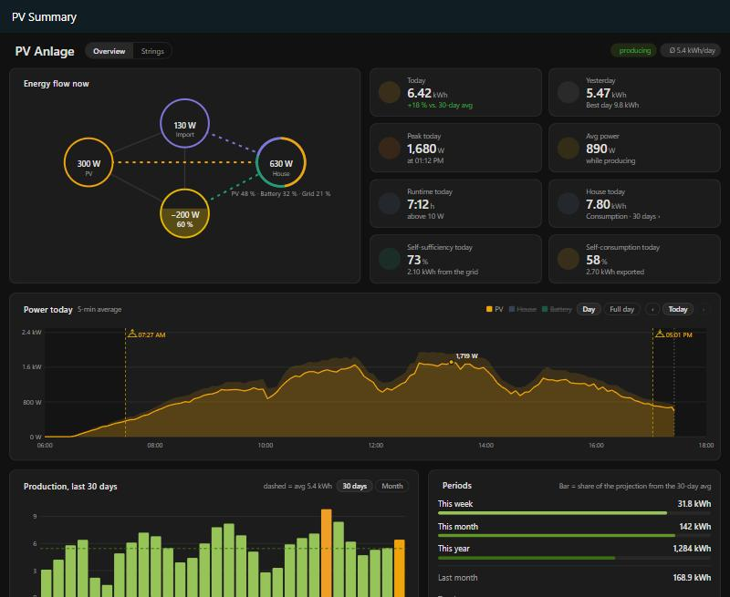

# PV Summary, Home Assistant Integration

[English version](README.md)

Du gibst nur **einen Sensor mit der aktuellen PV-Leistung** (W oder kW) an, die Integration rechnet daraus Energie und Statistiken. Optional kommen Netz-Zähler (oder Hausverbrauch), beliebig viele Akkus und einzelne PV-Strings dazu. Ein eigenes Dashboard erscheint automatisch als **PV Summary** in der Seitenleiste.

Voraussetzung ist Home Assistant **2025.3** oder neuer. Einrichtung und Dashboard gibt es auf Deutsch und Englisch, sie folgen der Spracheinstellung von Home Assistant.

## Installation über HACS

1. HACS → Menü (⋮) → **Benutzerdefinierte Repositories**
2. Repository `https://github.com/berwil84afk/ha-pv-summary`, Typ **Integration** → Hinzufügen
3. „PV Summary“ in HACS suchen → Herunterladen → Home Assistant neu starten
4. **Einstellungen → Geräte & Dienste → Integration hinzufügen → „PV Summary“**

## Manuelle Installation

1. Ordner `custom_components/pv_overview` nach `/config/custom_components/pv_overview` kopieren
   (z. B. mit dem File-Editor- oder Samba-Add-on).
2. Home Assistant neu starten.
3. **Einstellungen → Geräte & Dienste → Integration hinzufügen → „PV Summary“**.
4. Name, PV-Leistungssensor, Schwelle (Standard 10 W) und optional Netzleistung (Zähler), Hausverbrauch und bisherigen Zählerstand eingeben.

Später änderbar über **Konfigurieren** an der Integration: Quellsensor, Netz, Hausverbrauch und Schwelle. Akkus und Strings legst du an der Integration über **Akku hinzufügen** und **String hinzufügen** an.

## Netz und Hausverbrauch (optional)

- **Netzleistung (Zähler)**: Sensor am Netz-Zähler, positiv = Bezug, negativ = Einspeisung (W oder kW). Meldet dein Zähler es umgekehrt, setze **Vorzeichen Netz umkehren**. Daraus entstehen *Netzbezug heute/gesamt* und *Einspeisung heute/gesamt*. Die Gesamt-Zähler kannst du im **Energie-Dashboard** unter „Stromnetz“ eintragen.
- **Hausverbrauch** wird dann berechnet: Haus = PV + Netz − Akku (Akku positiv beim Laden). Daraus entstehen *Hausverbrauch*, *Hausverbrauch heute* und *Hausverbrauch gesamt*.
- Hast du stattdessen einen Sensor, der wirklich den Verbrauch des Hauses misst, trage ihn unter **Hausverbrauch** ein. Ohne Netz-Zähler wird die Netzleistung dann daraus berechnet (Netz = Haus + Akku − PV).
- Den Sensor *Netzleistung* gibt es in beiden Fällen, also mit Netz-Zähler oder mit Hausverbrauch. Netzbezug und Einspeisung als Energie gibt es nur mit Netz-Zähler.
- Beim Update auf v1.7 wird ein bisher unter „Hausverbrauch“ eingetragener Sensor einmalig ins Feld **Netzleistung (Zähler)** übernommen, weil das bis v1.6 meist der Zähler war. Misst dein Sensor wirklich den Hausverbrauch, trag ihn unter **Konfigurieren** wieder dort ein und leere das Netz-Feld.

## Akkus (optional, beliebig viele)

An der Integration unter **Einstellungen → Geräte & Dienste → PV Summary** legst du über **Akku hinzufügen** einen oder mehrere Akkus an. Jedes Feld ist optional:

| Feld | Erwartet |
|---|---|
| Akkustand | Sensor in % |
| Lade-/Entladeleistung | **ein** Sensor mit Vorzeichen in W oder kW (positiv = Laden) |
| Vorzeichen umkehren | einschalten, wenn dein Sensor beim Entladen positive Werte meldet |
| Kapazität | kWh, gewichtet den gemeinsamen Akkustand |
| Akkuspannung, Akkutemperatur | Sensoren in V/mV bzw. °C/°F |

- Jeder Akku bekommt ein eigenes Gerät mit *Akkustand*, *Akkuleistung*, *Akku geladen heute*, *Akku entladen heute* und, falls angegeben, Spannung und Temperatur.
- An der Anlage gibt es die Summen aller Akkus: *Akkuleistung*, *Akku Lade-/Entladeleistung*, *Akku geladen/entladen heute und gesamt* sowie den *Kombinierten Akkustand*. Der kombinierte Akkustand ist nach Kapazität gewichtet, wenn bei allen Akkus eine Kapazität eingetragen ist, sonst der einfache Durchschnitt.
- *Akku geladen gesamt* und *Akku entladen gesamt* kannst du im **Energie-Dashboard** unter „Batteriespeicher“ eintragen.
- Ein bis v1.5 eingerichteter Akku wird beim Update automatisch als „Akku“ übernommen.

## Strings (optional)

Über **String hinzufügen** trägst du einzelne PV-Strings ein: Leistung (Pflicht), Spannung und Strom (optional). Jeder String bekommt ein eigenes Gerät mit *Leistung*, *Produktion heute*, *Produktion gesamt* und gegebenenfalls *Spannung* und *Strom*. Sobald mindestens ein String eingetragen ist, hat das Dashboard einen zusätzlichen Tab **Strings**.

## Erzeugte Sensoren

| Sensor | Einheit | Beschreibung |
|---|---|---|
| Aktuelle Leistung | W | Leistung des Quellsensors in W (kW wird umgerechnet, negativ → 0). Grundlage aller Berechnungen, sofort aktualisiert |
| Gesamtproduktion | kWh | Fortlaufender Zähler, im **Energie-Dashboard** als Solarproduktion nutzbar |
| Produktion heute / gestern | kWh | `gestern` hat Attribut `history` mit den letzten 30 Tagen |
| Produktion diese Woche / dieser Monat / letzter Monat / dieses Jahr | kWh | `dieser Monat` hat Attribut `months` mit Monatswerten |
| Spitzenleistung heute | W | Attribut `time` = Zeitpunkt |
| Spitzenleistung Rekord | W | Allzeit-Maximum mit Zeitpunkt |
| Durchschnittsleistung heute | W | Ø Leistung während der Produktionszeit |
| Produktionszeit heute | h | Zeit über der Schwelle |
| Ø Tagesproduktion 7 / 30 / 365 Tage / gesamt | kWh/d | Nur abgeschlossene Tage |
| Bester Tag | kWh | Attribut `date` |
| Hausverbrauch / heute / gesamt | W / kWh | mit Netz-Zähler berechnet oder gemessen |
| Netzleistung | W | positiv = Bezug, negativ = Einspeisung; mit Netz-Zähler oder Hausverbrauch |
| Netzbezug / Einspeisung heute und gesamt | kWh | nur mit Netz-Zähler |
| Akku …, String … | | siehe oben |

## Wie gerechnet wird

- Energie = Leistung × Zeit (Riemann-Summe, Wert gilt bis zur nächsten Änderung), aktualisiert alle 30 s.
- kW/MW-Sensoren werden automatisch in W umgerechnet. Negative Werte von PV, Hausverbrauch und Strings werden als 0 gewertet. Netz und Akku behalten ihr Vorzeichen.
- Ist der Quellsensor `unavailable`, wird über die Lücke **nicht** integriert. Während Home Assistant aus ist, wird nichts gezählt.
- Tage, Wochen (ISO, ab Montag), Monate und Jahre werden um Mitternacht abgeschlossen, auch wenn HA über Mitternacht aus war.
- Der Tag der Ersteinrichtung ist unvollständig und zählt nicht in die Durchschnitte.
- Daten liegen in `/config/.storage/pv_overview.<entry_id>` und überleben Neustarts.

## Eigenes Dashboard

Die Integration bringt ihr eigenes Dashboard mit. Es erscheint nach dem Einrichten automatisch als **PV Summary** in der Seitenleiste, ohne HACS-Karten, ohne YAML und ohne Anpassen von Entity-IDs. Die Texte erscheinen auf Deutsch, wenn Home Assistant auf Deutsch eingestellt ist, sonst auf Englisch.

- **Energiefluss jetzt**: PV, Haus, Akku und Netz mit animierten Linien (Netz und Haus nur mit Netz-Zähler oder Hausverbrauch). Die Linien folgen einer echten Bilanz: PV lädt zuerst den Akku, dann versorgt sie das Haus, der Rest geht ins Netz. Ein entladender Akku versorgt das Haus und speist den Überschuss ein. Jeder Knoten ist klickbar, beim Akku Leistung und Akkustand getrennt. Der Akku-Knoten füllt sich mit dem Akkustand (unter 25 % rot, bis 75 % gelb, darüber grün). Der Rand des Haus-Knotens ist in farbige Bögen geteilt und zeigt, woher der Hausverbrauch gerade kommt (PV, Akku, Netz), mit den Prozenten darunter.
- **Kennzahlen**: Heute (mit Vergleich zum Ø der letzten 30 Tage), Gestern, Spitze heute, Ø Leistung, Laufzeit, Haus heute. Mit Netz-Zähler kommen **Autarkie heute** (Anteil des Hausverbrauchs, der nicht aus dem Netz kam) und **Eigenverbrauch heute** (Anteil der PV-Produktion, der nicht eingespeist wurde) dazu. Ein Klick auf „Haus heute“ öffnet ein Fenster mit dem Hausverbrauch der letzten 30 Tage, daneben die PV-Produktion je Tag. Über den Balken stehen Verbrauch und Autarkie des Tages, oben der Ø Hausverbrauch und die Autarkie des Zeitraums. Gibt es noch keine 30 Tage, erscheinen nur die vorhandenen Tage; ein unvollständiger erster Tag ist schraffiert und zählt nicht in die Durchschnitte. Antippen oder überfahren zeigt Haus, PV und Autarkie eines Tages.
- **Leistung heute**: Tageskurve, geglättet auf 5 Minuten. Die Linie zeigt den Mittelwert je 5 Minuten, das blasse Band dahinter reicht vom kleinsten bis zum größten Wert. Die markierte Spitze ist das beste 5-Minuten-Mittel, der Tooltip zeigt Mittel, Minimum und Maximum. Sonnenaufgang und -untergang am Standort deiner Home-Assistant-Installation sind als gestrichelte Linien mit Uhrzeit eingezeichnet, die Nacht ist leicht abgedunkelt. Anfangs ist nur PV zu sehen, Haus, Akku und Netz blendest du mit einem Klick auf den Namen in der Legende ein (und wieder aus). Mit ‹ Heute › blätterst du durch vergangene Tage. Die Achse richtet sich nach dem höchsten Wert. Mit **Tag** zeigt die Zeitachse nur den Zeitraum mit Sonne bzw. Leistung (je eine halbe Stunde Rand), mit **Ganzer Tag** alle 24 Stunden; die Wahl merkt sich der Browser. Sind Haus, Akku oder Netz eingeblendet, ist immer der ganze Tag zu sehen.
- **Zoomen** in den Tageskurven: **Strg + Mausrad** (oder die Zoom-Geste am Touchpad) zoomt um die Stelle unter dem Mauszeiger, Shift + Mausrad verschiebt den Ausschnitt. Ziehen mit der Maus wählt einen Zeitraum. Am Handy zoomst und verschiebst du mit zwei Fingern. Doppelklick oder doppeltes Tippen setzt den Zoom zurück.
- **Produktion der letzten 30 Tage** (umschaltbar auf einzelne Monate) und **der letzten 12 Monate** als Balken, mit Durchschnittslinie und hervorgehobenem besten Tag. Negative Werte (Zählersprung in der Statistik) erscheinen als kurzer roter Balken.
- **Zeiträume** (Woche, Monat, Jahr, letzter Monat und hervorgehoben der Gesamtwert) und **Akkus** (jeder Akku einzeln, darunter die Summen)
- **Durchschnitt und Rekorde**: bester Tag und Leistungsrekord mit Datum, darunter die Durchschnitte über 7, 30 und 365 Tage und gesamt, jeweils mit einem Balken im Verhältnis zum besten Tag
- Tab **Strings**: Leistung je String über den Tag, ebenfalls auf 5 Minuten geglättet, wahlweise als **Linien** (mit Band) oder **Gestapelt** (die Flächen ergeben zusammen die gesamte PV-Leistung, der Tooltip zeigt die Summe), mit Tage blättern und Zoom. Dazu Ertrag je String (aktuelle Leistung groß, heute, gestern, gesamt), Produktion je String der letzten 30 Tage und Anteil jedes Strings am Gesamtertrag.
- Ein Klick auf einen Wert im Energiefluss, bei den Akkus oder Strings öffnet den Verlauf des Sensors. Bei mehreren Anlagen schaltest du oben rechts zwischen ihnen um.
- Helles und dunkles Design folgen deinem Home-Assistant-Theme, auf dem Handy wird alles untereinander angezeigt.

Solange Daten geladen werden, zeigen die Diagramme einen Ladehinweis. Die Diagramme nutzen den Verlauf und die Langzeitstatistik von Home Assistant. Die 30-Tage- und 12-Monats-Balken füllen sich deshalb erst nach und nach.

Nach einem Update lädt der Browser das Dashboard manchmal noch aus dem Cache. Dann hilft einmal **Strg+F5**.
