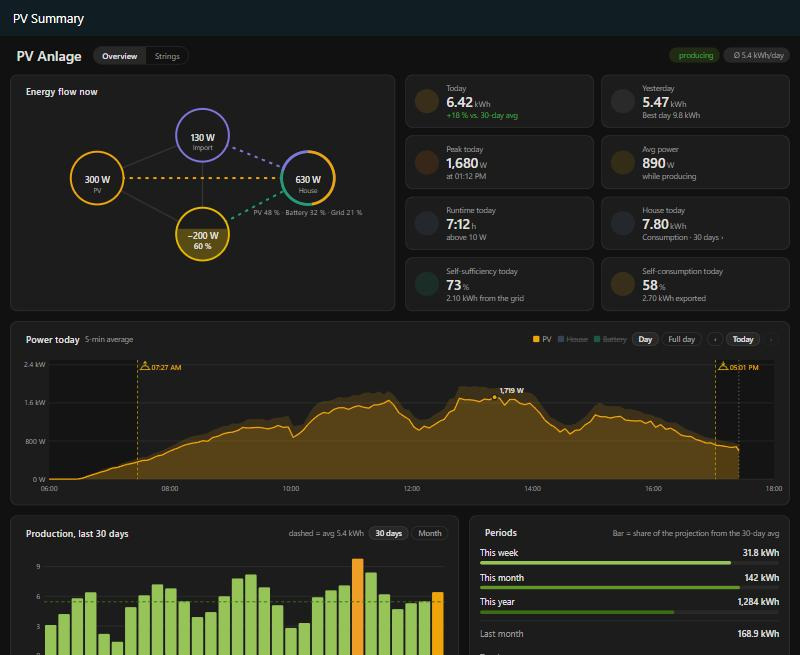

# PV Summary, Home Assistant Integration

[Deutsche Version](README.de.md)

You only provide **one sensor with the current PV power** (W or kW), and the integration calculates energy and statistics from it. Optionally you can add a grid meter (or house consumption), any number of batteries and individual PV strings. A dedicated dashboard appears automatically as **PV Summary** in the sidebar.

Requires Home Assistant **2025.3** or newer. Setup and dashboard are available in English and German and follow the Home Assistant language setting.

## Installation via HACS

1. HACS → menu (⋮) → **Custom repositories**
2. Repository `https://github.com/berwil84afk/ha-pv-summary`, type **Integration** → Add
3. Search for "PV Summary" in HACS → Download → restart Home Assistant
4. **Settings → Devices & services → Add integration → "PV Summary"**

## Manual installation

1. Copy the folder `custom_components/pv_overview` to `/config/custom_components/pv_overview`
   (for example with the File editor or Samba add-on).
2. Restart Home Assistant.
3. **Settings → Devices & services → Add integration → "PV Summary"**.
4. Enter a name, the PV power sensor, the threshold (default 10 W) and optionally the grid power (meter), house consumption and previous total production.

You can change the source sensor, grid, house consumption and threshold later via **Configure** on the integration. Batteries and strings are added on the integration via **Add battery** and **Add string**.

## Grid and house consumption (optional)

- **Grid power (meter)**: sensor at the grid meter, positive = import, negative = export (W or kW). If your meter reports it the other way round, enable **Invert grid sign**. This creates *Grid import today/total* and *Grid export today/total*. You can add the total counters to the **Energy dashboard** under "Electricity grid".
- **House consumption** is then calculated: house = PV + grid − battery (battery positive while charging). This creates *House consumption*, *House consumption today* and *House consumption total*.
- If you have a sensor that really measures the consumption of the house instead, enter it under **House consumption**. Without a grid meter the grid power is then calculated from it (grid = house + battery − PV).
- The *Grid power* sensor exists in both cases, with a grid meter or with house consumption. Grid import and export as energy are only available with a grid meter.
- When updating to v1.7, a sensor previously entered as "house consumption" is moved once to the **Grid power (meter)** field, because up to v1.6 that was usually the meter. If your sensor really measures the house consumption, enter it there again under **Configure** and clear the grid field.

## Batteries (optional, any number)

On the integration under **Settings → Devices & services → PV Summary** you add one or more batteries via **Add battery**. Every field is optional:

| Field | Expects |
|---|---|
| State of charge | sensor in % |
| Charge/discharge power | **one** signed sensor in W or kW (positive = charging) |
| Invert sign | enable if your sensor reports positive values while discharging |
| Capacity | kWh, weights the combined state of charge |
| Battery voltage, battery temperature | sensors in V/mV or °C/°F |

- Each battery gets its own device with *Battery level*, *Battery power*, *Battery charged today*, *Battery discharged today* and, if configured, voltage and temperature.
- The system device has the sums of all batteries: *Battery power*, *Battery charging/discharging power*, *Battery charged/discharged today and total* and the *Combined battery level*. The combined level is weighted by capacity if every battery has a capacity, otherwise it is the plain average.
- You can add *Battery charged total* and *Battery discharged total* to the **Energy dashboard** under "Home battery storage".
- A battery set up with v1.5 or earlier is taken over automatically as "Akku" when updating.

## Strings (optional)

Via **Add string** you enter individual PV strings: power (required), voltage and current (optional). Each string gets its own device with *Power*, *Production today*, *Production total* and, if configured, *Voltage* and *Current*. As soon as at least one string exists, the dashboard has an additional **Strings** tab.

## Sensors

| Sensor | Unit | Description |
|---|---|---|
| Current power | W | Power of the source sensor in W (kW is converted, negative → 0). Basis of all calculations, updated immediately |
| Total production | kWh | Continuous counter, usable as solar production in the **Energy dashboard** |
| Production today / yesterday | kWh | `yesterday` has the attribute `history` with the last 30 days |
| Production this week / this month / last month / this year | kWh | `this month` has the attribute `months` with monthly values |
| Peak power today | W | attribute `time` = time of the peak |
| Peak power record | W | all-time maximum with time |
| Average power today | W | average power during production time |
| Production time today | h | time above the threshold |
| Avg daily production 7 / 30 / 365 days / overall | kWh/d | completed days only |
| Best day | kWh | attribute `date` |
| House consumption / today / total | W / kWh | calculated with a grid meter, or measured |
| Grid power | W | positive = import, negative = export; with a grid meter or house consumption |
| Grid import / export today and total | kWh | grid meter only |
| Battery …, string … | | see above |

## How it calculates

- Energy = power × time (Riemann sum, a value applies until the next change), updated every 30 s.
- kW/MW sensors are converted to W automatically. Negative values of PV, house consumption and strings count as 0. Grid and battery keep their sign.
- If the source sensor is `unavailable`, the gap is **not** integrated. Nothing is counted while Home Assistant is off.
- Days, weeks (ISO, starting Monday), months and years are closed at midnight, even if HA was off over midnight.
- The day of the initial setup is incomplete and does not count towards the averages.
- Data is stored in `/config/.storage/pv_overview.<entry_id>` and survives restarts.

## Dashboard

The integration brings its own dashboard. After setup it appears automatically as **PV Summary** in the sidebar, without HACS cards, without YAML and without adjusting entity IDs. Texts are shown in German if Home Assistant is set to German, otherwise in English.

- **Energy flow now**: PV, house, battery and grid with animated lines (grid and house only with a grid meter or house consumption). The lines follow a real balance: PV charges the battery first, then supplies the house, and the rest goes to the grid. A discharging battery supplies the house and exports the surplus. Every node is clickable, for the battery power and state of charge separately. The battery node fills with the state of charge (red below 25 %, yellow up to 75 %, green above). The border of the house node is split into coloured arcs showing where the house consumption currently comes from (PV, battery, grid), with the percentages below.
- **Key figures**: today (compared with the average of the last 30 days), yesterday, peak today, average power, runtime, house today. With a grid meter you also get **self-sufficiency today** (share of the house consumption that did not come from the grid) and **self-consumption today** (share of the PV production that was not exported). Clicking "house today" opens a window with the house consumption of the last 30 days next to the PV production per day. Above the bars you see the consumption and self-sufficiency of each day, at the top the average house consumption and the self-sufficiency of the period. Until there are 30 days, only the existing days are shown; an incomplete first day is hatched and does not count towards the averages. Hover or tap a day to see house, PV and self-sufficiency.
- **Power today**: daily curve smoothed to 5 minutes. The line shows the 5-minute average, and the faint band behind it spans the lowest to the highest value. The marked peak is the best 5-minute average, and the tooltip shows average, minimum and maximum. Sunrise and sunset at the location of your Home Assistant installation are drawn as dashed lines with their time, and the night is slightly darkened. A faint yellow area behind the curve shows the height of the sun over the day; its highest point (the highest sun position of the day) is drawn at the height of the highest value in the chart. This shows how well the power follows the sun. At first only PV is shown; click a name in the legend to show house, battery and grid (and to hide them again). Use ‹ Today › to browse past days. The axis adapts to the highest value. With **Day** the time axis only shows the period with sun or power (with half an hour on each side), with **Full day** all 24 hours; the browser remembers your choice. With house, battery or grid shown, the whole day is always displayed.
- **Zooming** in the daily curves: **Ctrl + scroll wheel** (or the pinch gesture on a touchpad) zooms around the mouse pointer, and Shift + scroll wheel moves the visible range. Dragging with the mouse selects a time range. On a phone, zoom and move with two fingers. Double-click or double-tap resets the zoom.
- **Production, last 30 days** (switchable to single months) and **last 12 months** as bars, with an average line and the best day highlighted. Negative values (meter jump in the statistics) appear as a short red bar.
- **Periods** (week, month, year, last month and the highlighted total) and **Batteries** (each battery individually, the sums below)
- **Averages and records**: best day and power record with their date, below them the averages over 7, 30 and 365 days and overall, each with a bar relative to the best day
- **Strings** tab: power per string over the day, also smoothed to 5 minutes and with the sun arc, either as **Lines** (with band) or **Stacked** (the areas add up to the total PV power, and the tooltip shows the total), with day browsing and zoom. Plus production per string (current power shown large, today, yesterday, total), production per string over the last 30 days and the share of each string in the total production.
- Clicking a value in the energy flow, the batteries or the strings opens the history of that sensor. With several systems you switch between them at the top right.
- Light and dark design follow your Home Assistant theme, and on a phone everything is stacked vertically.

While data is loading, the charts show a loading hint. Today and the current month come from the live sensors in the bar charts, because the long-term statistics of Home Assistant are only updated every hour. The charts use the history and long-term statistics of Home Assistant, so the 30-day and 12-month bars fill up over time.

After an update the browser sometimes still loads the dashboard from its cache. Press **Ctrl+F5** once to reload it.
