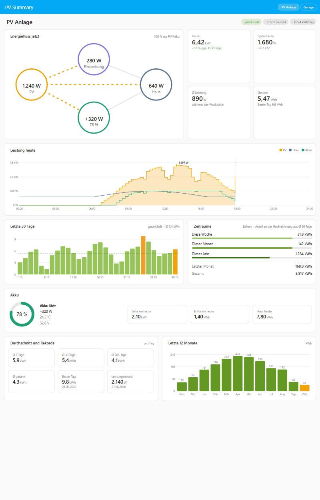

# PV Summary – Home Assistant Integration

Du gibst nur **einen Sensor mit der aktuellen PV-Leistung** (W oder kW) an – die Integration rechnet daraus Energie und Statistiken. Optional kommen Netz-Zähler (oder Hausverbrauch), beliebig viele Akkus und einzelne PV-Strings dazu. Ein eigenes Dashboard erscheint automatisch als **PV Summary** in der Seitenleiste.



## Installation über HACS

1. HACS → Menü (⋮) → **Benutzerdefinierte Repositories**
2. Repository `https://github.com/berwil84afk/ha-pv-summary`, Typ **Integration** → Hinzufügen
3. „PV Summary“ in HACS suchen → Herunterladen → Home Assistant neu starten
4. **Einstellungen → Geräte & Dienste → Integration hinzufügen → „PV Summary“**

## Manuelle Installation

1. Ordner `custom_components/pv_overview` nach `/config/custom_components/pv_overview` kopieren
   (z. B. mit dem File-Editor- oder Samba-Add-on).
2. Home Assistant neu starten.
3. **Einstellungen → Geräte & Dienste → Integration hinzufügen → „PV Summary“**.
4. Name, PV-Leistungssensor, Schwelle (Standard 10 W) und optional Netzleistung (Zähler), Hausverbrauch und bisherigen Zählerstand eingeben.

Später änderbar über **Konfigurieren** an der Integration: Quellsensor, Netz, Hausverbrauch und Schwelle. Akkus und Strings legst du an der Integration über **Akku hinzufügen** und **String hinzufügen** an.

## Netz und Hausverbrauch (optional)

- **Netzleistung (Zähler)**: Sensor am Netz-Zähler, positiv = Bezug, negativ = Einspeisung (W oder kW). Meldet dein Zähler es umgekehrt, setze **Vorzeichen Netz umkehren**. Daraus entstehen *Netzleistung*, *Netzbezug heute/gesamt* und *Einspeisung heute/gesamt*; die Gesamt-Zähler kannst du im **Energie-Dashboard** unter „Stromnetz“ eintragen.
- **Hausverbrauch** wird dann berechnet: Haus = PV + Netz − Akku (Akku positiv beim Laden). Daraus entstehen *Hausverbrauch*, *Hausverbrauch heute* und *Hausverbrauch gesamt*.
- Hast du stattdessen einen Sensor, der wirklich den Verbrauch des Hauses misst, trage ihn unter **Hausverbrauch** ein. Ohne Netz-Zähler wird die Netzleistung dann daraus berechnet (Netz = Haus + Akku − PV).
- Beim Update auf v1.7 wird ein bisher unter „Hausverbrauch“ eingetragener Sensor einmalig ins Feld **Netzleistung (Zähler)** übernommen, weil das bis v1.6 meist der Zähler war. Misst dein Sensor wirklich den Hausverbrauch, trag ihn unter **Konfigurieren** wieder dort ein und leere das Netz-Feld.

## Akkus (optional, beliebig viele)

An der Integration unter **Einstellungen → Geräte & Dienste → PV Summary** legst du über **Akku hinzufügen** einen oder mehrere Akkus an. Jedes Feld ist optional:

| Feld | Erwartet |
|---|---|
| Akkustand | Sensor in % |
| Lade-/Entladeleistung | **ein** Sensor mit Vorzeichen in W oder kW (positiv = Laden) |
| Vorzeichen umkehren | einschalten, wenn dein Sensor beim Entladen positive Werte meldet |
| Kapazität | kWh, gewichtet den gemeinsamen Akkustand |
| Akkuspannung, Akkutemperatur | Sensoren in V/mV bzw. °C/°F |

- Jeder Akku bekommt ein eigenes Gerät mit *Akkustand*, *Akkuleistung*, *Akku geladen heute*, *Akku entladen heute* und, falls angegeben, Spannung und Temperatur.
- An der Anlage gibt es die Summen aller Akkus: *Akkuleistung*, *Akku Lade-/Entladeleistung*, *Akku geladen/entladen heute und gesamt* sowie den gemeinsamen *Akkustand*. Der gemeinsame Akkustand ist nach Kapazität gewichtet, wenn bei allen Akkus eine Kapazität eingetragen ist, sonst der einfache Durchschnitt.
- *Akku geladen gesamt* und *Akku entladen gesamt* kannst du im **Energie-Dashboard** unter „Batteriespeicher“ eintragen.
- Ein bis v1.5 eingerichteter Akku wird beim Update automatisch als „Akku“ übernommen.

## Strings (optional)

Über **String hinzufügen** trägst du einzelne PV-Strings ein: Leistung (Pflicht), Spannung und Strom (optional). Jeder String bekommt ein eigenes Gerät mit *Leistung*, *Produktion heute*, *Produktion gesamt* und gegebenenfalls *Spannung* und *Strom*. Sobald mindestens ein String eingetragen ist, hat das Dashboard einen zusätzlichen Tab **Strings**.

## Erzeugte Sensoren

| Sensor | Einheit | Beschreibung |
|---|---|---|
| Aktuelle Leistung | W | Leistung des Quellsensors in W (kW wird umgerechnet, negativ → 0) – Grundlage aller Berechnungen, sofort aktualisiert |
| Gesamtproduktion | kWh | Fortlaufender Zähler – im **Energie-Dashboard** als Solarproduktion nutzbar |
| Produktion heute / gestern | kWh | `gestern` hat Attribut `history` mit den letzten 30 Tagen |
| Produktion diese Woche / dieser Monat / letzter Monat / dieses Jahr | kWh | `dieser Monat` hat Attribut `months` mit Monatswerten |
| Spitzenleistung heute | W | Attribut `time` = Zeitpunkt |
| Spitzenleistung Rekord | W | Allzeit-Maximum mit Zeitpunkt |
| Durchschnittsleistung heute | W | Ø Leistung während der Produktionszeit |
| Produktionszeit heute | h | Zeit über der Schwelle |
| Ø Tagesproduktion 7 / 30 / 365 Tage / gesamt | kWh/d | Nur abgeschlossene Tage |
| Bester Tag | kWh | Attribut `date` |
| Hausverbrauch / heute / gesamt | W / kWh | mit Netz-Zähler berechnet oder gemessen |
| Netzleistung | W | positiv = Bezug, negativ = Einspeisung |
| Netzbezug / Einspeisung heute und gesamt | kWh | nur mit Netz-Zähler |
| Akku …, String … | | siehe oben |

## Wie gerechnet wird

- Energie = Leistung × Zeit (Riemann-Summe, Wert gilt bis zur nächsten Änderung), aktualisiert alle 30 s.
- kW/MW-Sensoren werden automatisch in W umgerechnet, negative Werte als 0 gewertet.
- Ist der Quellsensor `unavailable`, wird über die Lücke **nicht** integriert. Während Home Assistant aus ist, wird nichts gezählt.
- Tage, Wochen (ISO, ab Montag), Monate und Jahre werden um Mitternacht abgeschlossen – auch wenn HA über Mitternacht aus war.
- Der Tag der Ersteinrichtung ist unvollständig und zählt nicht in die Durchschnitte.
- Daten liegen in `/config/.storage/pv_overview.<entry_id>` und überleben Neustarts.

## Eigenes Dashboard

Die Integration bringt ihr eigenes Dashboard mit. Es erscheint nach dem Einrichten automatisch als **PV Summary** in der Seitenleiste – ohne HACS-Karten, ohne YAML und ohne Anpassen von Entity-IDs.

- **Energiefluss jetzt**: PV, Haus, Akku und Netz mit animierten Linien (Netz und Haus nur mit Netz-Zähler oder Hausverbrauch). Die Linien folgen einer echten Bilanz: PV deckt zuerst das Haus, dann den Akku, der Rest geht ins Netz; ein entladender Akku versorgt das Haus und speist den Überschuss ein. Jeder Knoten ist klickbar, beim Akku Leistung und Akkustand getrennt.
- **Kennzahlen**: Heute (mit Vergleich zum Ø der letzten 30 Tage), Gestern, Spitze heute, Ø Leistung, Laufzeit, Haus heute
- **Leistung heute**: Tageskurve für PV, Haus, Akku und Netz mit markierter Spitze und Tooltip beim Überfahren
- **Produktion der letzten 30 Tage** und **der letzten 12 Monate** als Balken, mit Durchschnittslinie und hervorgehobenem besten Tag
- **Zeiträume**, **Akkus** (jeder Akku einzeln, darunter die Summen) sowie **Durchschnitt und Rekorde**
- Tab **Strings**: Leistung je String heute im Vergleich, Ertrag je String (heute, gestern, gesamt), Produktion je String der letzten 30 Tage und Anteil jedes Strings am Gesamtertrag
- Ein Klick auf einen Wert im Energiefluss, bei den Akkus oder Strings öffnet den Verlauf des Sensors. Bei mehreren Anlagen schaltest du oben rechts zwischen ihnen um.
- Helles und dunkles Design folgen deinem Home-Assistant-Theme, auf dem Handy wird alles untereinander angezeigt.

Die Diagramme nutzen den Verlauf und die Langzeitstatistik von Home Assistant. Die 30-Tage- und 12-Monats-Balken füllen sich deshalb erst nach und nach.

## Alternatives YAML-Dashboard

Wer lieber ein normales Lovelace-Dashboard möchte: In [`dashboard/pv-summary-dashboard.yaml`](dashboard/pv-summary-dashboard.yaml) liegt ein komplettes Dashboard mit zwei Ansichten:

- **Übersicht**: aktuelle Leistung als Tacho, Tageswerte, Verlauf über 24 Stunden, Tages- und Monatsproduktion als Balken, Perioden, Durchschnitte, Rekorde und eine Akku-Kurzübersicht
- **Akku**: Akkustand, Leistung, Spannung und Temperatur mit Verläufen sowie geladene und entladene Energie pro Tag

So bindest du es ein:

1. **Einstellungen → Dashboards → Dashboard hinzufügen → „Neues Dashboard von Grund auf“**, z. B. mit dem Namen „PV“
2. Dashboard öffnen → Stift (Bearbeiten) → **⋮ → Rohkonfigurationseditor**
3. Den gesamten Inhalt durch die Datei ersetzen und speichern

Hinweise:

- Die Entity-IDs gehen von einer Anlage namens „PV Anlage“ aus (`sensor.pv_anlage_…`). Bei einem anderen Namen das Präfix per Suchen und Ersetzen anpassen.
- Ohne Akku blendet sich der Akku-Abschnitt der Übersicht automatisch aus. Die Ansicht „Akku“ kannst du dann löschen.
- Die Skala des Leistungstachos (0–2000 W) an deine Anlage anpassen (`max:` und die `segments`).

## Beispielkarten

Die Entity-IDs hängen vom Namen ab, den du beim Einrichten vergibst. In den Beispielen heißt die Anlage „PV Anlage“, daher das Präfix `sensor.pv_anlage_…`. Bei einem anderen Namen bitte anpassen.

### Ausführliche Karte

```yaml
type: vertical-stack
cards:
  - type: heading
    heading: PV-Anlage
    icon: mdi:solar-power-variant
    badges:
      - type: entity
        entity: sensor.pv_anlage_produktionszeit_heute
        icon: mdi:timer-sand
        color: grey
  - type: gauge
    entity: sensor.pv_anlage_aktuelle_leistung
    name: Aktuelle Leistung
    min: 0
    max: 2000
    needle: true
    segments:
      - from: 0
        color: '#9e9e9e'
      - from: 100
        color: '#fbc02d'
      - from: 600
        color: '#ff9800'
      - from: 1200
        color: '#43a047'
  - type: grid
    columns: 2
    square: false
    cards:
      - type: tile
        entity: sensor.pv_anlage_produktion_heute
        name: Heute
        icon: mdi:solar-power
        color: amber
      - type: tile
        entity: sensor.pv_anlage_spitzenleistung_heute
        name: Spitze heute
        icon: mdi:flash
        color: orange
      - type: tile
        entity: sensor.pv_anlage_durchschnittsleistung_heute
        name: Ø Leistung
        icon: mdi:chart-bell-curve-cumulative
        color: yellow
      - type: tile
        entity: sensor.pv_anlage_produktion_gestern
        name: Gestern
        icon: mdi:calendar-arrow-left
        color: grey
  - type: history-graph
    title: Leistungsverlauf
    hours_to_show: 24
    entities:
      - entity: sensor.pv_anlage_aktuelle_leistung
        name: Leistung
  - type: heading
    heading: Produktion
    heading_style: subtitle
  - type: grid
    columns: 2
    square: false
    cards:
      - type: tile
        entity: sensor.pv_anlage_produktion_diese_woche
        name: Diese Woche
        icon: mdi:calendar-week
        color: light-green
      - type: tile
        entity: sensor.pv_anlage_produktion_dieser_monat
        name: Dieser Monat
        icon: mdi:calendar-month
        color: green
      - type: tile
        entity: sensor.pv_anlage_produktion_letzter_monat
        name: Letzter Monat
        icon: mdi:calendar-arrow-left
        color: teal
      - type: tile
        entity: sensor.pv_anlage_produktion_dieses_jahr
        name: Dieses Jahr
        icon: mdi:calendar-star
        color: cyan
      - type: tile
        entity: sensor.pv_anlage_gesamtproduktion
        name: Gesamt
        icon: mdi:sigma
        color: blue
  - type: statistics-graph
    title: Tagesproduktion (30 Tage)
    entities:
      - entity: sensor.pv_anlage_produktion_heute
        name: Produktion
    stat_types:
      - change
    period: day
    days_to_show: 30
    chart_type: bar
  - type: heading
    heading: Durchschnitt & Rekorde
    heading_style: subtitle
  - type: grid
    columns: 3
    square: false
    cards:
      - type: tile
        entity: sensor.pv_anlage_o_tagesproduktion_7_tage
        name: Ø 7 Tage
        icon: mdi:numeric-7-box-outline
        color: purple
        vertical: true
      - type: tile
        entity: sensor.pv_anlage_o_tagesproduktion_30_tage
        name: Ø 30 Tage
        icon: mdi:calendar-range
        color: deep-purple
        vertical: true
      - type: tile
        entity: sensor.pv_anlage_o_tagesproduktion_gesamt
        name: Ø Gesamt
        icon: mdi:chart-line
        color: indigo
        vertical: true
  - type: grid
    columns: 2
    square: false
    cards:
      - type: tile
        entity: sensor.pv_anlage_bester_tag
        name: Bester Tag
        icon: mdi:trophy
        color: amber
      - type: tile
        entity: sensor.pv_anlage_spitzenleistung_rekord
        name: Leistungsrekord
        icon: mdi:trophy-award
        color: red
```

### Kompakte Karte

```yaml
type: vertical-stack
cards:
  - type: glance
    title: PV heute
    entities:
      - entity: sensor.pv_anlage_produktion_heute
        name: Heute
      - entity: sensor.pv_anlage_spitzenleistung_heute
        name: Spitze
      - entity: sensor.pv_anlage_durchschnittsleistung_heute
        name: Ø Leistung
      - entity: sensor.pv_anlage_produktionszeit_heute
        name: Laufzeit
  - type: entities
    title: PV Summary
    entities:
      - sensor.pv_anlage_gesamtproduktion
      - sensor.pv_anlage_produktion_gestern
      - sensor.pv_anlage_produktion_diese_woche
      - sensor.pv_anlage_produktion_dieser_monat
      - sensor.pv_anlage_produktion_letzter_monat
      - sensor.pv_anlage_produktion_dieses_jahr
      - type: divider
      - sensor.pv_anlage_o_tagesproduktion_7_tage
      - sensor.pv_anlage_o_tagesproduktion_30_tage
      - sensor.pv_anlage_o_tagesproduktion_gesamt
      - sensor.pv_anlage_bester_tag
      - sensor.pv_anlage_spitzenleistung_rekord
  - type: statistics-graph
    title: Tagesproduktion
    entities:
      - sensor.pv_anlage_produktion_heute
    stat_types:
      - change
    period: day
    days_to_show: 30
    chart_type: bar
```
